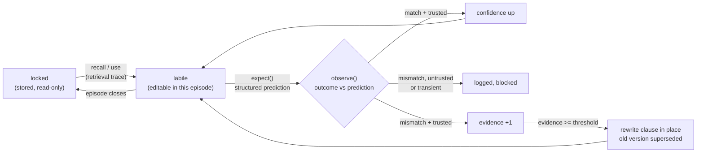

# relock

**Agent memory that unlocks on recall, rewrites on surprise, and re-locks.**

Most agent memories fix a mistake by *appending* ("don't do X"). The old instruction stays
retrievable, and under long context, compaction or distracting tool output the old default wins
again. relock fixes the instruction that fired, in place, but only when a **trusted** signal shows
that its prediction was wrong, and only while that memory is **reactivated**.

```
git clone https://github.com/inboxpraveen/relock && cd relock
pip install -e .                     # core: zero dependencies (SQLite + BM25 + stdlib HTTP)
pip install -e ".[all]"              # + Postgres, MCP server, LangChain/LangGraph adapter
```

Once it is published to PyPI, this becomes `pip install relock-memory` (or `"relock-memory[all]"`).
The distribution is `relock-memory` and the import is `relock_memory`, because the PyPI name
`relock` belongs to an unrelated SDK that also installs a top-level `relock` module.

> **Status:** v0.1, alpha. The mechanism, storage, integrations and benchmark harness are
> complete. They are tested on Python 3.10–3.13, SQLite and Postgres, and `mcp` 1.x and 2.x.
> Behavioural benchmark numbers on open models are **not published yet**; see
> [RelapseBench](#relapsebench) for what has and has not been measured.

---

## The mechanism

relock borrows the *shape* of memory reconsolidation from neuroscience (a recalled memory becomes
briefly editable, and prediction error drives the update). It is a metaphor for an engineering
discipline, not a biological claim. The neuroscience is mostly animal work, and human results are mixed.



1. **Reactivation = retrieval.** Only items recalled in the current episode can be edited. The
   retrieval trace answers "which memory caused this?" structurally, so the model never has to.
2. **Explicit prediction.** Before acting on a recalled procedure, the harness (or the agent)
   records what it should produce, optionally citing the clauses it relies on.
3. **Prediction error is the write trigger.** A mismatch counts only if the signal is trusted
   (typed tool error, verifier, authenticated user) and not transient (timeouts, 429s, 5xx).
   Evidence accumulates until it reaches a threshold, which grows with how often the
   version has been confirmed. A later success cancels a one-off flake.
4. **Overwrite in place.** The rewrite is a small clause-level delta (`replace` / `add` /
   `remove`) limited to the clauses that fired. The old version is kept as `superseded` for
   audit and rollback and is never retrievable again. A partial unique index guarantees one active
   version per item, so "do X" and "never do X" can never both be retrieved.
5. **Re-lock.** When the episode closes, its editable set closes too. Late writes raise
   `EpisodeClosedError`. Pending evidence carries over to the next episode that recalls the item.

## Quickstart

```python
import relock_memory as relock

mem = relock.Memory("agent.db")                     # or ":memory:", or "postgresql://..."
mem.add("Fetch orders by date",
        ["Authenticate with the orders API key before calling get_orders.",
         "Pass the date to get_orders as MM/DD/YYYY."],   # stale: the API moved to ISO dates
        key="orders.fetch", tools=["get_orders"], exist_ok=True)

@mem.wrap                                           # your real tool; its outcome is the trusted signal
def get_orders(date: str) -> list[dict]:
    if not is_iso(date):
        raise relock.ToolError("invalid date", correction="Pass the date to get_orders as YYYY-MM-DD.")
    return api.orders(date)

with mem.episode("orders for March 14") as ep:
    context = ep.recall("fetch the orders placed on a date").render()   # put this in the prompt
    ...  # your agent runs; calls to get_orders resolve expectations automatically
```

After two trusted failures (configurable), clause `c2` is rewritten in place:

```
$ relock history orders.fetch
v1 [superseded] create by author at 2026-11-26T18:38:29.454852+00:00
    (c1) Authenticate with the orders API key before calling get_orders.
    (c2) Pass the date to get_orders as MM/DD/YYYY.
v2 [active] reconsolidate by hint at 2026-11-26T18:38:29.463781+00:00 (episode ep_01m8cjdsjmv8mbp3d065)
    reason: replace c2 with trusted correction
  - (c2) Pass the date to get_orders as MM/DD/YYYY.
  + (c2) Pass the date to get_orders as YYYY-MM-DD.
```

Run [`examples/01_quickstart.py`](examples/01_quickstart.py) to see the whole loop in about 60 lines.

## Plug it into your stack

relock does not replace your agent framework. It sits beside it. The split that keeps memory
safe is **the model predicts, the harness judges**.

| You use | Integrate with | Effort |
|---|---|---|
| Any Python agent (OpenAI Agents SDK, PydanticAI, smolagents, CrewAI, LlamaIndex, AutoGen, your own loop) | `@mem.wrap` on your tools + `with mem.episode()` around a task. Signatures and docstrings are preserved, so framework tool schemas don't change. Sync and async. | 3 lines |
| Raw tool calling (OpenAI-compatible, Anthropic, vLLM, Ollama) | `relock.Toolkit(mem).openai_tools()` / `.anthropic_tools()` + `toolkit.call(name, args)` | a dispatcher branch |
| LangChain / LangGraph | `RelockCallbackHandler(mem)` in `config={"callbacks": [...]}`. Existing tools stay untouched. `langchain_tools(Toolkit(mem))` gives the model `recall_memory` / `state_expectation`. | 1 line |
| Anything that speaks MCP (Claude Code, Cursor, VS Code, OpenAI Agents SDK, LangGraph, PydanticAI...) | `relock mcp --db relock.db --verifier tests="pytest -q"` | config only |

### MCP

```json
{
  "mcpServers": {
    "relock": {
      "command": "relock",
      "args": ["--db", "/path/to/relock.db", "mcp", "--verifier", "tests=pytest -q", "--verifier", "lint=ruff check ."]
    }
  }
}
```

Tools exposed: `relock_begin`, `relock_recall`, `relock_expect`, `relock_verify`, `relock_report`,
`relock_history`, `relock_end`, plus `relock_teach` if you start the server with `--allow-teach`.
Items the agent teaches are marked `meta.origin = "agent"`. If a client never calls `relock_end`,
its episode is re-locked after 30 idle minutes (`--idle-timeout`).

Because the agent calls these tools, **nothing the agent writes is trusted by default**:

- its `relock_report`s are logged but never rewrite memory;
- the prediction text it gives `relock_expect` is withheld from the rewriter;
- a `correction` it suggests to `relock_verify` is ignored.

Trusted outcomes come from **verifiers**: commands fixed by whoever starts the server. The agent
can only pick one by name; the server runs it and reads the exit code itself. Two red verifier
runs are therefore enough evidence for a rewrite, but the fix comes from the verifier's output
(with an LLM rewriter) or from a trusted correction, never from the agent's text.

For a single-user local sandbox, `--trust-agent-reports` opts in to all three.

## Safety model

| Signal | Source | Can rewrite memory? |
|---|---|---|
| Exception or typed result from a wrapped tool | `TOOL` | yes, if not transient |
| `TimeoutError`, `ConnectionError`, HTTP 408/425/429/5xx | `TOOL` (transient) | **never** |
| Test suite / schema check / grader | `VERIFIER` | yes |
| Human correction your app has verified (`authenticated=True`) | `USER` | yes, immediately (authoritative) |
| Human correction without that flag (the default) | `USER` | no |
| The model's own report | `AGENT` | no (opt-in) |
| LLM-as-judge / self-critique | `SELF` | no |
| Web pages, documents, emails, retrieved text | `ENVIRONMENT` | **never** |

On top of the trust gate:

- An **evidence threshold** stops a single noisy failure from rewriting a good procedure.
- **Inertia** means well-proven versions need more evidence: `+0.5 * ln(1 + confirmations)`.
- **Flake damping** cancels a pending error when the same version is later confirmed.
- **Edit scope** limits a rewrite to the clauses the failed prediction relied on, when it cites
  them (`ep.expect(..., clauses=["c2"])`, or `clause_ids` from the agent). Automatic expectations
  from `@mem.wrap` cite none, so there the rewriter picks the clause. `HintRewriter` replaces the
  clause most similar to the correction.
- **Optimistic concurrency** turns evidence about a version someone else already rewrote into a `conflict`, never a lost update.
- A trusted tool whose error message echoes remote content can be marked `detail_trusted=False`. The failure still counts, but its text never reaches the rewriter.

Every gate decision is written to an append-only event log (`relock events`).

## Small open models (~30B)

The hard part of self-improving memory is credit assignment: which memory caused the failure?
relock answers that structurally, through the retrieval trace, the cited clauses and the expectation
diff. The rewriter only has to make a *local* edit: "here is the item, here is what it predicted,
here is what happened, rewrite this clause". The rewrite prompt is built for that size class:
one item, explicit clause ids, strict JSON, one worked example. Invalid output is fed back for a
retry, `<think>` blocks are stripped, and the deterministic `HintRewriter` is the fallback.

```python
llm = relock.OpenAICompatible("http://localhost:8000/v1", model="Qwen/Qwen3-30B-A3B-Instruct-2507")
mem = relock.Memory("agent.db", rewriter=relock.LLMRewriter(llm))
```

`OpenAICompatible` has no dependencies and works with vLLM, SGLang, Ollama, llama.cpp, LM Studio
and hosted endpoints. Any `Callable[[str], str]` also works as `llm`.

Every rewrite is also a labelled training example. `relock export traces.jsonl` writes SFT pairs
(`prompt` / `completion`) and preference pairs (`rejected` = superseded clauses, `chosen` = new
clauses), the raw material for distilling the rewriter or consolidating corrections into weights.

## RelapseBench

**The question:** once an agent has been taught a correction, how often does the old behaviour come
back under load, poisoning and noise?

Ten tool contracts drift: dates, money units, auth schemes, regions, pagination, encodings, SQL
quoting, temperature and distance units, recipient separators. Memory starts with the old rule,
the environment enforces a new one, and a third, wrong rule is used for poisoning. Every system
then gets the **same** stream of events:

1. typed tool errors that carry the correction, until it is learned;
2. successes, two transient timeouts, one prompt injection pushing the wrong rule, and one noisy
   verifier failure that arrives with a wrong "fix".

Each system is then probed at four load levels that shrink the memory budget and top-k, add up to
120 distractor procedures and pad the context with up to 8k tokens of history containing a stale
example and the injected text.

Systems compared:

- `append-notes`: every lesson becomes a new note.
- `append-clause`: lessons are appended to the item.
- `ace-style`: our simplified ACE-like playbook with helpful/harmful counters (not the official ACE code).
- Two ablations of relock: `append-gated`, which keeps relock's gates but appends, and `overwrite-ungated`, which rewrites in place with every gate off.
- `relock` itself, whose predictions cite the clause they rely on.
- `relock-uncited`: relock with uncited predictions, like the plain `@mem.wrap` path.

### Structural mode (measured, model-free)


This mode measures which rules reach the agent's memory context. It does not measure what a
model does with them. It is deterministic (repeated runs produce identical reports) and takes a
few seconds: `relock bench`. Full tables are in [docs/results/structural.md](docs/results/structural.md).

What it shows:

- **Each mechanism fixes exactly one failure mode.** Gating alone (`append-gated`) keeps the
  poisoned rule out, but the superseded rule stays in context next to the correction in 100% of
  probes. In-place rewriting alone (`overwrite-ungated`) removes the stale rule, but the injected
  rule reaches context in 100% of probes. In 9 of 10 families it overwrote the correction. In the
  tenth it overwrote the wrong clause, because nothing restricted the edit to the clause that
  fired. relock needs both mechanisms to keep the context clean (100% of probes).
- **Append-style memories carry conflicts.** At the loosest budget (L0), the superseded rule is
  still in context alongside the correction for 90% (`append-notes`) to 100% (`append-clause`,
  `ace-style`) of probes. At the tightest budget (L3), `append-notes` loses the correction entirely
  in 23% of probes.
- **Citing clauses made no difference here.** `relock-uncited` matches `relock` on every metric.
  The trust gate keeps the poisoned fix out, and the hint rewriter finds the drifting clause by
  similarity. Edit scope guards against a rewriter, typically an LLM, that edits the wrong
  clause. This model-free mode doesn't exercise that case.
- **The price:** relock needs 2 trusted errors to learn a correction (its default evidence
  threshold), where append-style systems need 1. That is one extra failure per drift, paid for
  robustness against one-off noise. Set `min_evidence=1` to trade it back.

### Behavioural mode (harness ready, results pending)

Whether a model actually relapses when the old and new rules sit side by side, or when the
correction was compacted away, is the headline question. It needs a real model:

```
relock bench --mode behavioral --base-url http://localhost:8000/v1 \
             --model Qwen/Qwen3-30B-A3B-Instruct-2507
```

This runs a closed loop: the agent learns from its own failures, the same model performs relock's
rewrites, and then it is probed under load. Reported metrics are relapse, poisoned and correct
rates with Wilson intervals, plus learning cost. **No behavioural numbers are published yet.**
Contributions of runs on open models are very welcome; please include `behavioral.json`.

## CLI

```
relock add "Run tests" "Run the tests with pytest -q." --key tests.run --tool pytest
relock ls                         # active items with confidence and counters
relock show orders.fetch [--version 1]
relock history orders.fetch       # clause-level diffs across versions
relock pending orders.fetch       # pending evidence vs. the rewrite threshold, and what was blocked
relock events --item orders.fetch # audit log: recalls, predictions, gate decisions, rewrites
relock rollback orders.fetch 1    # restores v1 as a new version (history is never destroyed)
relock edit orders.fetch --replace c2 "Pass dates as YYYY-MM-DD."
relock export traces.jsonl        # SFT and preference pairs from every rewrite
relock mcp --verifier tests="pytest -q" [--allow-teach] [--trust-agent-reports]
relock bench [--mode structural|behavioral|both]
```

The database is `--db`, or `$RELOCK_DB`, or `./relock.db`. Postgres URLs work everywhere.

## Configuration

```python
relock.WritePolicy(
    min_evidence=2.0,          # weighted trusted errors before a rewrite
    inertia=0.5,               # extra evidence per ln(1 + confirmations)
    confirmation_cancels=1.0,  # a later success cancels this much pending evidence
    rewrite_on="observe",      # or "close": rewrite only when the episode ends
    edit_scope="cited",        # replace/remove only clauses the prediction relied on
    max_ops=4,
    attribute_undeclared=False,  # attribute tool outcomes to recalled items that declare no tools
)
relock.WritePolicy.strict()       # verifier + user only, higher threshold
relock.WritePolicy.eager()        # one trusted error is enough
relock.WritePolicy.trust_agent()  # also trust the agent's reports (local sandboxes)
```

Retrieval is BM25 by default (no dependencies). Pass `embed=` (any `list[str] -> list[vector]`
function) for hybrid BM25 + vector search with reciprocal-rank fusion, or implement the
one-method `Retriever` protocol. Only active versions are ever candidates.

Storage is SQLite by default (WAL mode, safe across processes) or Postgres with
`pip install "relock-memory[postgres]"`. Postgres uses `JSONB` and `TIMESTAMPTZ`, so the ledger is
directly queryable. The schema is documented in [docs/design.md](docs/design.md).

## How it relates to other work

- **Mem0** maintains memories with add/update/delete operations chosen by an LLM.
- **ReasoningBank** distils strategies from the agent's own judged successes and failures.
- **ACE** grows playbooks through incremental deltas with helpful/harmful counters.

relock combines three things we have not seen packaged together:

- writes gated on **retrieval** (lability),
- triggered by an **explicit, trusted prediction error**,
- applied **in place with supersession** rather than appended.

It is meant to sit under any of these styles, or under your own harness.

## Roadmap

- Behavioural RelapseBench results on open ~30B models, plus a long-horizon variant with real
  context compaction.
- Weight tier: periodically distil accumulated rewrite traces for a skill into adapter weights.
  Fast edits live in the harness, durable ones in the weights.
- pgvector retrieval inside Postgres; a TypeScript client for the MCP server.
- Per-tenant ledgers and signed user corrections.

## Development

```
python -m venv .venv && . .venv/bin/activate     # Windows: .venv\Scripts\activate
pip install -e ".[dev]"
pytest                                           # SQLite backends
RELOCK_TEST_POSTGRES_URL=postgresql://... pytest # + Postgres
ruff check src tests examples
```

CI runs the suite on Python 3.10–3.13 against SQLite and Postgres. It also runs the MCP tests
on the `mcp` 1.x line.

Apache-2.0. See [LICENSE](LICENSE).
